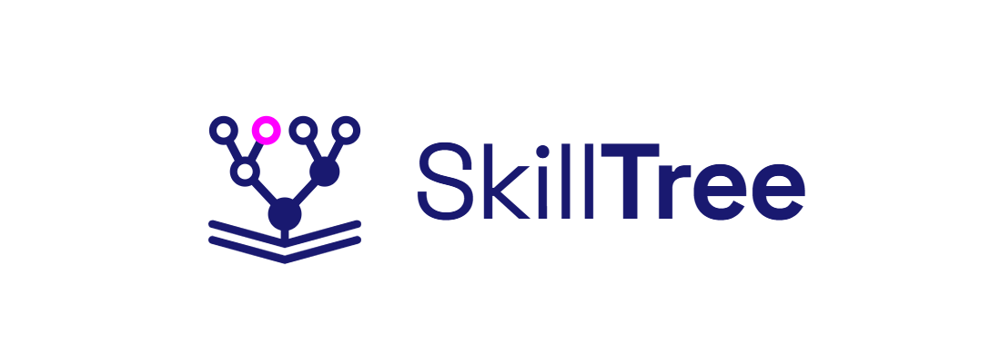

<p align="center">
  
</p>

<p align="center">
  <strong>Descubra o que aprender em TI e em que ordem.</strong>
</p>

<p align="center">
  
  
  
</p>

<p align="center">
  
  
  
  
  
</p>

# SkillTree

**Aplicação de estruturas de dados para modelagem de trilhas de aprendizagem em Tecnologia da Informação.**

Projeto desenvolvido para a Mostra Científica 2026.

> **Status:** em desenvolvimento. O ambiente do projeto está pronto; a modelagem dos dados, as regras de liberação e a interface ainda serão construídas (veja o [roteiro](docs/planejamento/00-roteiro-de-fases.md)).

## 🌱 O problema

Na área de TI, linguagens, ferramentas e especializações mudam o tempo todo, e muita gente aprende sozinha. Isso amplia o acesso ao conteúdo, mas dificulta saber **quais habilidades** desenvolver e **em que ordem**. O projeto se relaciona às metas 4.4 e 8.3 dos Objetivos de Desenvolvimento Sustentável (ODS), sobre competências para o emprego e trabalho decente.

## 💡 A ideia

O SkillTree organiza trilhas de aprendizagem relacionando objetivos profissionais, habilidades e seus pré-requisitos. Como uma habilidade só é liberada depois das que a antecedem, essas relações são modeladas com estruturas de dados:

- 🌳 **Árvore:** cada nó é uma habilidade e seus ancestrais são os pré-requisitos. Por meio de percursos, calcula-se quais habilidades estão **concluídas**, **disponíveis** ou **bloqueadas**.
- 🕸️ **Grafo direcionado acíclico (DAG):** evolução para habilidades com mais de um pré-requisito. A **ordenação topológica** gera uma sequência de estudo válida a partir do que a pessoa já domina.

O diferencial é que a trilha se **adapta ao conhecimento prévio** de quem usa, em vez de seguir um caminho único e rígido.

A carreira de referência é **Desenvolvedor Front-end**.

## 🧭 Como vai funcionar

1. A pessoa cria um perfil simples e escolhe a carreira.
2. Um modal pergunta quais tecnologias ela já conhece.
3. A trilha é liberada, mostrando o passo a passo com habilidades **concluídas**, **disponíveis** e **bloqueadas**.
4. Ao concluir uma habilidade, a trilha se atualiza e a pessoa ganha **XP**.

> Funcionalidades planejadas. O andamento de cada uma fica no [BACKLOG.md](BACKLOG.md).

## 🛠️ Tecnologias

- [React](https://react.dev/) e [TypeScript](https://www.typescriptlang.org/)
- [Vite](https://vite.dev/) (servidor de desenvolvimento e build)
- [Vitest](https://vitest.dev/) (testes)

A lógica das estruturas de dados fica separada da interface, em `src/dominio/`, em TypeScript puro.

## 🚀 Como executar

Pré-requisito: [Node.js](https://nodejs.org/) 20 ou superior.

```bash
npm install     # instala as dependências
npm run dev     # inicia o servidor de desenvolvimento
npm test        # executa os testes
npm run build   # gera a versão de produção
```

## 📁 Estrutura

```
dados/             dados da carreira em JSON (a criar)
src/dominio/       estruturas de dados e regras, sem React
src/componentes/   interface em React (a criar)
docs/planejamento/ planejamento de cada fase
BACKLOG.md         itens e prioridades
```

## 🔬 Metodologia

A pesquisa segue a **Design Science Research (DSR)**, em cinco etapas: identificação do problema, definição dos objetivos da solução, desenvolvimento, demonstração e avaliação.

## 📚 Fontes dos dados

O mapeamento das habilidades e de seus pré-requisitos toma como ponto de partida o [roadmap.sh](https://roadmap.sh/frontend), usado como referência. As descrições das habilidades e a **recomendação de materiais de estudo** serão pesquisadas e curadas pelos autores do projeto, que reescrevem o conteúdo com suas próprias palavras. Cada habilidade registra as fontes consultadas.

## 📄 Licença

A definir.
